# TaskDar - Pemvis Tugas 5: Aplikasi Manajemen Tugas Mahasiswa

Aplikasi mobile pencatatan, pengelolaan, dan pemantauan tugas perkuliahan berbasis React Native dan Expo SDK 58. Proyek ini dikembangkan untuk memenuhi penugasan praktikum Tugas 5 (Pertemuan 5) mata kuliah Pemrograman Visual I pada program studi S1 Teknik Informatika STIKOM Poltek Cirebon.

---

## Identitas Pengembang & Penugasan

- Nama Mahasiswa : Badar Rahman
- NIM            : 14524303
- Program Studi  : S1 Teknik Informatika
- Kelas          : TI
- Semester       : 5 (Ganjil)
- Kampus         : STIKOM Poltek Cirebon
- Mata Kuliah    : Pemrograman Visual I (TI361)
- Penugasan      : Tugas 5 (Pertemuan 5)
- Dosen Pengampu : Rifky Hilmanudin, S.Kom., M.Kom.
- Repositori Git : https://github.com/DarRahman/Pemvis

---

## Struktur Berkas & Arsitektur Direktori Proyek

```text
Pemvis/
├── App.js                      # Entry point React Native Expo fungsional (7 Hooks & FlatList)
├── app.json                    # Konfigurasi metadata aplikasi Expo (TaskDar SDK 58)
├── package.json                # Dependensi pustaka proyek (React 19, Expo 58, Lucide, Tailwind)
├── index.html                  # Dokumen induk simulator web
├── vite.config.ts              # Konfigurasi bundler Vite dev server
├── tsconfig.json               # Konfigurasi compiler TypeScript
├── README.md                   # Dokumentasi resmi proyek akademik
├── public/                     # Aset statis publik aplikasi
│   ├── icon.png                # Ikon utama aplikasi TaskDar
│   └── assets/                 # Maskot dan stiker visual format WebP
│       ├── mascot-splash.webp  # Maskot utama layar pembuka TaskDar
│       ├── olympiad-trophy.webp# Aset piala target capaian akademik
│       ├── sticker-coding.webp # Stiker visual Pemrograman Visual I (TI361)
│       ├── sticker-robotics.webp# Stiker visual Robotika (TI362)
│       ├── sticker-data.webp   # Stiker visual Data Warehouse & Data Mining (SI309)
│       ├── sticker-security.webp# Stiker visual Keamanan Informasi & Jaringan (TI364)
│       └── sticker-oop.webp    # Stiker visual Pemodelan Berorientasi Objek (TI365)
├── screenshots/                # Dokumentasi 12 tangkapan layar antarmuka aplikasi
│   ├── 01_splash_screen.jpg
│   ├── 02_onboarding_login.jpg
│   ├── 03_halaman_utama_light.jpg
│   ├── 04_halaman_utama_dark.jpg
│   ├── 05_tambah_tugas_part1.jpg
│   ├── 06_tambah_tugas_part2.jpg
│   ├── 07_kalender_akademik.jpg
│   ├── 08_katalog_mata_kuliah.jpg
│   ├── 09_tambah_matkul_part1.jpg
│   ├── 10_tambah_matkul_part2.jpg
│   ├── 11_progres_leaderboard.jpg
│   └── 12_profil_pengaturan.jpg
└── src/                        # Kode sumber modular aplikasi antarmuka
    ├── App.tsx                 # Komponen induk navigasi tab dan state manager terpusat
    ├── main.tsx                # Titik masuk rendering root React DOM
    ├── firebase.ts             # Inisialisasi Firebase Authentication dan Cloud Firestore
    ├── index.css               # Gaya global Tailwind CSS dan utilitas Neo-brutalism
    ├── components/             # Komponen antarmuka modular
    │   ├── TaskCard.tsx        # Komponen kartu tugas (penerima Props dari induk)
    │   ├── AddTaskSheet.tsx    # Formulir modal penambahan tugas baru
    │   ├── AddCourseSheet.tsx  # Formulir modal penambahan mata kuliah baru
    │   ├── CalendarModal.tsx   # Modal kalender akademik penanggalan tenggat
    │   ├── StudentMascot.tsx   # Komponen render maskot interaktif mahasiswa
    │   └── WelcomeSplashModal.tsx# Modal onboarding identitas mahasiswa baru
    ├── data/
    │   └── initialTasks.ts     # Data awal 5 tugas autentik semester 5 dan taskReducer
    ├── types/
    │   └── task.ts             # Definisi antarmuka TypeScript (Task, Course, Student)
    └── utils/
        └── imageOptimizer.ts   # Utilitas penanganan dan resolusi aset WebP
```

---

## Fitur Aplikasi

1. Menampilkan Daftar Tugas Kuliah
   Daftar tugas dirender menggunakan komponen FlatList dengan data awal autentik semester 5. Setiap kartu tugas memuat judul tugas, mata kuliah, kategori, tanggal tenggat (deadline), dan status pengerjaan.

2. Penambahan Tugas Baru
   Formulir interaktif untuk menambahkan tugas kuliah baru dengan pilihan kategori (Praktikum, Proyek, Teori), pemilihan mata kuliah, tanggal batas waktu, serta lampiran dokumen.

3. Pengubahan Status Tugas (Toggle Status)
   Pengguna dapat memperbarui status tugas dari Belum Dikerjakan menjadi Selesai. Tugas yang telah selesai ditandai secara visual melalui teks judul tercoret (strikethrough), lencana centang hijau, dan warna kartu yang teredup.

4. Penghapusan Tugas
   Pengguna dapat menghapus tugas yang sudah tidak diperlukan melalui tombol aksi pada masing-masing kartu, dengan pembaruan daftar secara otomatis.

5. Pencarian Tugas Real-Time
   Fitur filter pencarian instan berdasarkan kata kunci nama tugas maupun nama mata kuliah.

6. Ringkasan & Statistik Tugas
   Kalkulasi ringkasan metrik yang menampilkan jumlah seluruh tugas terdaftar, tugas yang belum dikerjakan, dan tugas yang sudah selesai.

7. Katalog Mata Kuliah & Beban Studi
   Menampilkan daftar 5 mata kuliah semester berjalan lengkap dengan informasi SKS, dosen pengampu, ruang kelas, jadwal perkuliahan, dan persentase ketuntasan tugas per mata kuliah.

8. Kalender Akademik & Mode Tampilan
   Tampilan kalender penanggalan untuk memantau jadwal tenggat harian serta dukungan tema tampilan terang (Light Mode) dan gelap (Dark Mode).

---

## Arsitektur Props dan React Hooks

Proyek ini menerapkan arsitektur React Native fungsional dengan pemenuhan 7 ketentuan Hooks dan Props:

1. Props
   Komunikasi data satu arah dari komponen induk ke komponen turunan TaskCard untuk mengirimkan atribut tugas, data mata kuliah, dan fungsi aksi.

2. useState
   Mengelola nilai input form (judul, mata kuliah, kategori, deadline), kata kunci pencarian, serta status visibilitas modal dialog.

3. useEffect
   Memantau perubahan kata kunci pencarian secara reaktif dengan dependency array [searchQuery] dan mencatat log pencarian aktif ke konsol.

4. useMemo
   Menghitung ringkasan metrik tugas (total, pending, completed) serta kalkulasi leaderboard mata kuliah secara efisien, di mana perhitungan hanya dieksekusi ulang saat array tugas berubah.

5. useCallback
   Mengoptimasi referensi fungsi handler (handleAddTask, handleDeleteTask, handleToggleStatus) agar alamat memori fungsi tetap konsisten dan mencegah render ulang komponen turunan yang tidak perlu.

6. useRef
   Menyimpan referensi elemen input teks judul tugas (titleInputRef) untuk mengembalikan fokus kursor secara otomatis setelah proses penambahan tugas berhasil.

7. useReducer
   Mengelola state utama daftar tugas secara deterministik menggunakan reducer murni (taskReducer) dengan 4 aksi wajib:
   - ADD_TASK : Menambahkan data tugas baru ke daftar.
   - DELETE_TASK : Menghapus data tugas berdasarkan identitas unik.
   - TOGGLE_STATUS : Mengubah status tugas antara Belum Dikerjakan dan Selesai.
   - RESET_TASKS : Mengembalikan data tugas ke kondisi awal.

---

## Tangkapan Layar Aplikasi

| 01. Layar Pembuka (Splash) | 02. Identitas Mahasiswa | 03. Daftar Tugas (Light Mode) |
| :---: | :---: | :---: |
|  | 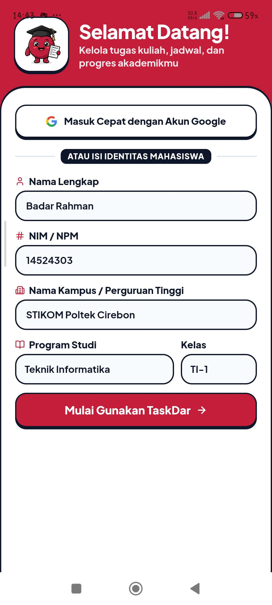 | 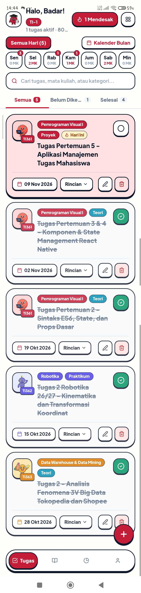 |

| 04. Daftar Tugas (Dark Mode) | 05. Tambah Tugas (Input) | 06. Tambah Tugas (Lampiran) |
| :---: | :---: | :---: |
| 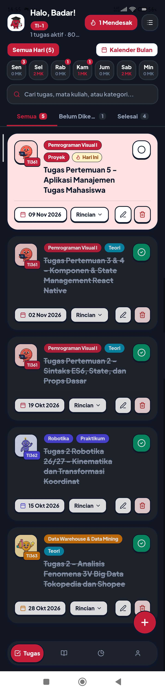 | 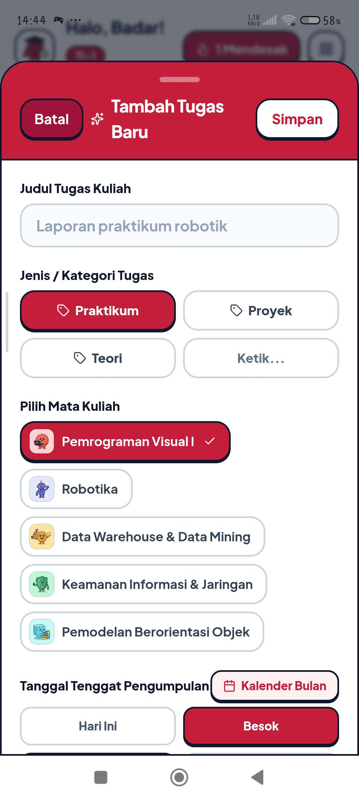 | 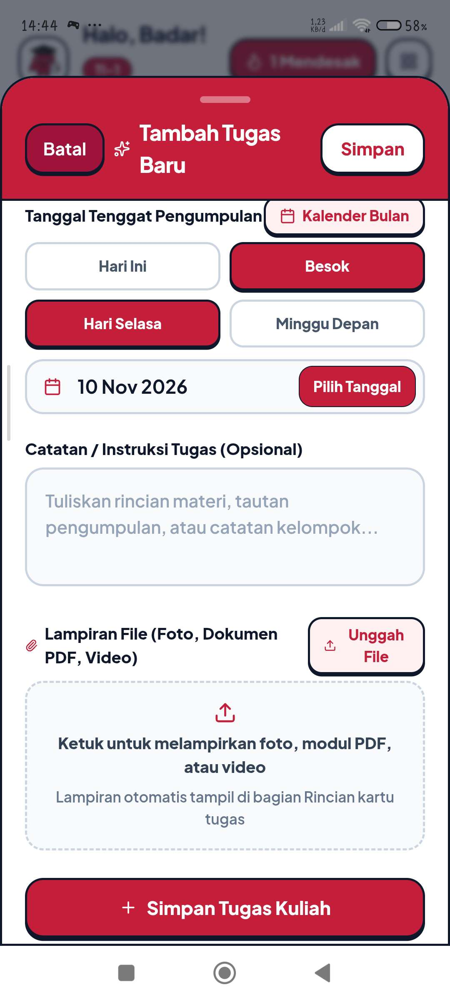 |

| 07. Kalender Akademik | 08. Katalog Mata Kuliah | 09. Tambah Matkul (Stiker) |
| :---: | :---: | :---: |
| 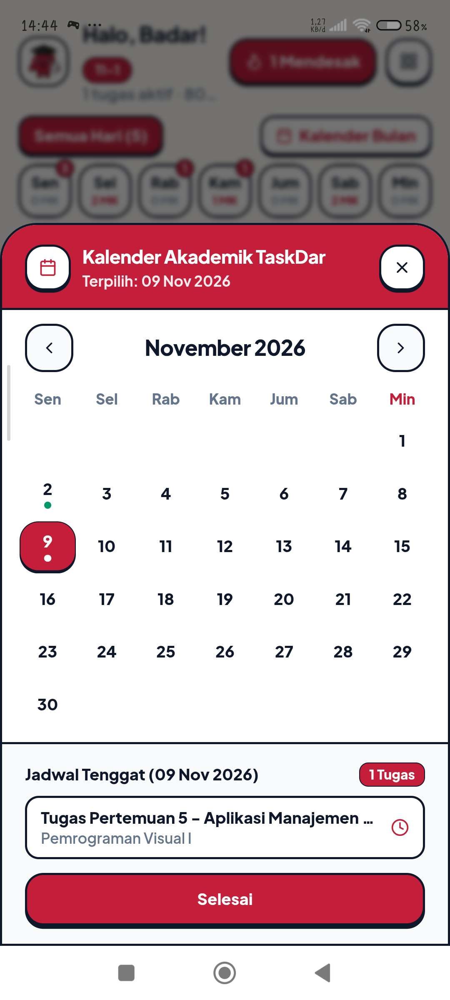 | 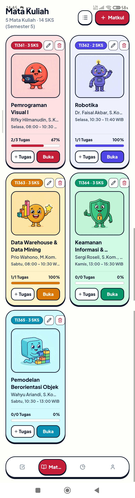 | 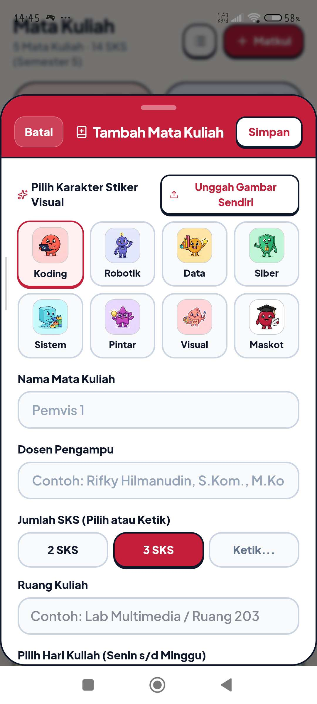 |

| 10. Tambah Matkul (Jadwal) | 11. Progres & Capaian | 12. Profil & Pengaturan |
| :---: | :---: | :---: |
| 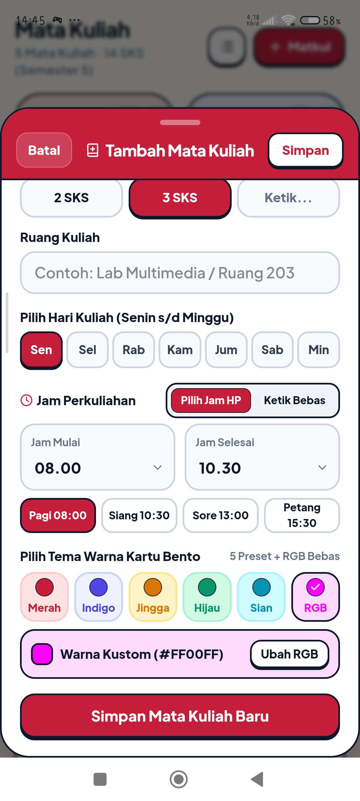 | 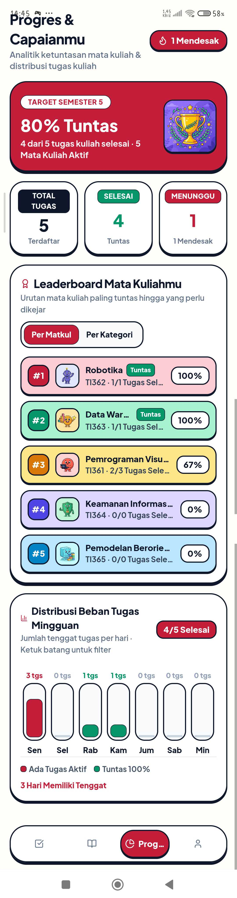 | 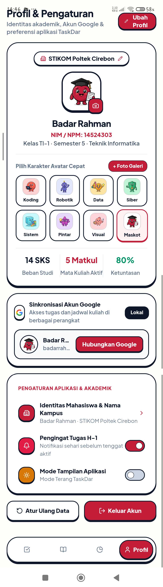 |

---

## Petunjuk Menjalankan Aplikasi

Prasyarat: Node.js (versi 18 ke atas) dan npm telah terpasang pada komputer.

1. Kloning repositori proyek:
   git clone https://github.com/DarRahman/Pemvis.git
   cd Pemvis

2. Pasang seluruh dependensi pustaka:
   npm install

3. Menjalankan aplikasi via Metro Bundler (Expo):
   npx expo start

4. Buka aplikasi Expo Go pada perangkat Android atau emulator, lalu pindai kode QR yang ditampilkan pada terminal atau masukkan tautan Metro Bundler lokal (misalnya exp://192.168.1.74:8081).
